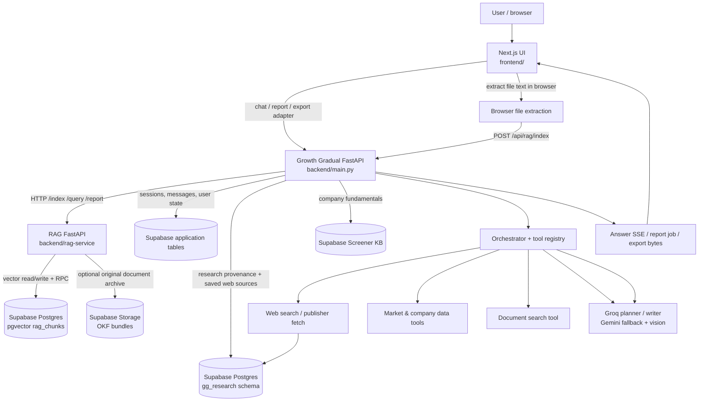
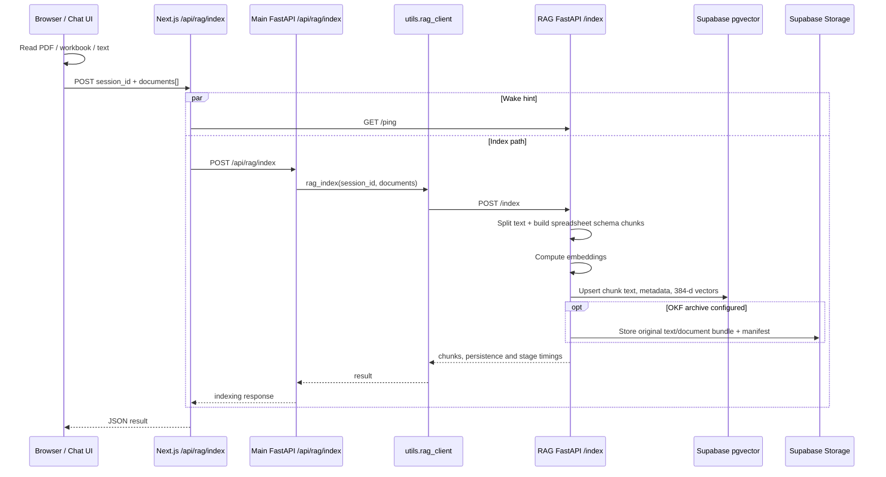
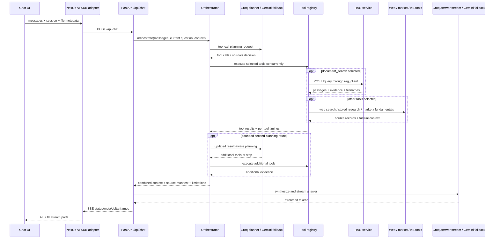
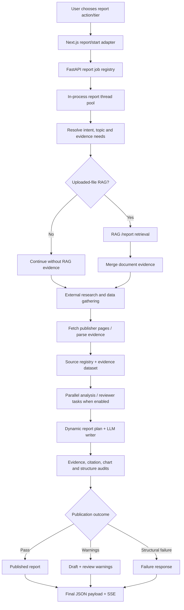

# Growth Gradual — end-to-end architecture and flow map

**Scope:** this document describes the source tree in this cleaned bundle, not a live infrastructure inspection. It follows the actual frontend routes, FastAPI router registration, RAG HTTP endpoints, Supabase clients and diagnostics code. Environment-dependent integrations are marked as optional/configured dependencies where appropriate.

## 1. Executive architecture view

Growth Gradual has **three application runtime services** in the active request path:

1. **Next.js frontend** (`frontend/`) — browser UI, browser-side file extraction, and server-side API adapters.
2. **Growth Gradual FastAPI backend** (`backend/main.py`) — main application API, orchestration, chat streaming, research/report pipeline and exports.
3. **RAG FastAPI service** (`backend/rag-service/main.py`) — separate service for document chunking, embeddings, persistent vector indexing and retrieval.

Supabase and the model/search/data providers are dependencies, not application microservices. Python modules under `backend/utils/` and `backend/routes/` are modules inside the single FastAPI backend process; they are **not** separate deployments. The report worker pools are also in-process thread pools, not separate worker services.

## 2. Deployable service boundaries

| Runtime / dependency | Source entry point | Responsibility | Deployment boundary |
|---|---|---|---|
| Next.js frontend | `frontend/src/app/`, `frontend/src/components/` | UI, chat transport, report UX, browser parsing, API adaptation | Separate Node/Next.js web service |
| Main API | `backend/main.py` | Application routes, orchestration, research, persistence, report jobs and exports | Separate Python/FastAPI web service |
| RAG API | `backend/rag-service/main.py` | Indexing, embedding, pgvector retrieval, reranking and OKF archival | Separate Python/FastAPI web service; default local port 7860 |
| Supabase Postgres | HTTP PostgREST and Postgres clients | Sessions, `gg_research`, fundamentals data and vector rows | Managed database dependency |
| Supabase Storage | `backend/rag-service/okf_store.py` | Original uploaded text/document bundles and manifests | Managed object-storage dependency; optional writes |
| LLM providers | `backend/utils/orchestrator.py`, chat/report routes | Tool planning, answer/report generation, review and vision extraction | External APIs |
| Web/market providers | `backend/utils/websearch.py`, tool/research modules | Current web evidence, publisher pages, market/company facts | External APIs/sites/data providers |

### Not active in the current chat path

The original Paperly Node services (`api-gateway`, `session-service`, `file-service`, `extraction-service`, `llm-service`) were explicitly listed by `backend/main.py` diagnostics as `not_in_active_chat_path`. The active chat uses Next.js proxies directly to Growth Gradual FastAPI; current file text is extracted in the browser and sent through the RAG API; FastAPI calls Groq/Gemini directly. Their old Node folders and the old `/api/upload` bridge have been removed from this cleaned source bundle. This is a source cleanup only; it does **not** delete or stop any separately deployed external Render service.

## 3. Frontend: what happens when the user submits input

### 3.1 Normal chat message

1. The chat UI is in `frontend/src/components/GrowthGradualChat.tsx`.
2. The UI transport posts to the Next.js AI SDK adapter `frontend/src/app/api/chat/ai-sdk/route.ts`.
3. That adapter normalizes UI messages to the backend body shape (`messages`, `fileContext`, `sessionId`, `hasRag`, `fileImages`) and generates/forwards an `X-Request-ID`.
4. It calls `POST {BACKEND_URL}/api/chat` and translates the backend's SSE events into UI-message stream parts: start, status, metadata, text deltas, errors and finish.
5. The browser receives text incrementally; the adapter does not wait for the full answer before starting the response stream.

There is also a standard Next.js `/api/chat` proxy, but the AI-SDK chat transport uses the direct adapter route above.

### 3.2 Attachment extraction and indexing

The current attachment path does **not** upload the binary to the retired Paperly file/extraction service. It extracts useful content in the browser first:

- **PDF:** PDF.js reads text from up to the first 30 pages. Page labels are retained in the extracted text. Scanned/image-only pages may not yield text; image/vision analysis is a separate path.
- **XLS/XLSX:** the `xlsx` package converts sheets to CSV-like text. Current caps are 40 sheets, 400 nonblank rows per sheet and 150,000 total extracted characters. Sheet names are included in the text.
- **Text/CSV and supported text-like formats:** read as text.
- **Images:** kept as image payloads for a separate vision path; they are not turned into textual RAG chunks by the browser text extractor itself.

After extraction the frontend posts document metadata and extracted text to `POST /api/rag/index` (`frontend/src/app/api/rag/index/route.ts`). That Next route sends the indexing request to the main backend `POST /api/rag/index`; it also pings the RAG service in parallel to help wake a sleeping deployment. The backend router calls `utils.rag_client.rag_index()`, which wakes/probes the RAG service and posts to the separate RAG service's `/index` endpoint.

The UI also sends safe extraction telemetry to `POST /api/diagnostics/client-event`: file type, byte count, extracted character count, stage status and elapsed time. The diagnostic payload is designed not to send the document text itself.

## 4. Main FastAPI backend: request orchestration

`backend/main.py` creates the FastAPI app and registers the router modules. Important route families include:

| Public backend route | Implemented by | What it does |
|---|---|---|
| `POST /api/chat` | `backend/routes/chat.py` | Main streamed conversational response |
| `POST /api/chat/charts` | `backend/routes/chat.py` | Inline chart generation |
| `POST /api/chat/report/start` | `backend/routes/report.py` | Queue report job and return `jobId` |
| `GET /api/chat/report/stream/{job_id}` | `backend/routes/report.py` | Progress, provisional preview and final result via SSE |
| `GET /api/chat/report/status/{job_id}` | `backend/routes/report.py` | Poll job state/result if stream is lost |
| `POST /api/chat/report` | `backend/routes/report.py` | Synchronous/direct report generation entry point |
| `POST /api/chat/report/pdf` | `backend/routes/pdf.py` | PDF export |
| `POST /api/chat/report/html` | `backend/routes/html_report.py` | HTML export |
| `POST /api/chat/report/docx` | `backend/routes/docx_report.py` | Editable Word export |
| `POST /api/chat/report/email` | `backend/routes/email.py` | Email report delivery when configured |
| `POST /api/chat/report/okf` | `backend/routes/okf.py` | OKF representation/export helper |
| `/api/rag/*` | `backend/routes/rag.py` | Backend-facing RAG index/query/delete/health proxy |
| `/api/stocks/*` | `backend/routes/stocks.py` | Screener fundamentals lookup |
| `/api/datasearch` | `backend/routes/datasearch.py` | Structured data-search API |
| `/api/knowledge/*` | `backend/routes/knowledge.py` | Website/article knowledge ingestion and retrieval paths |

The Next.js route handlers are adapters/proxies, not independent research workers. Their job is to forward requests to FastAPI, normalize the frontend stream contract, or handle server-side browser-facing concerns.

## 5. Chat request: query to answer

### 5.1 Backend chat flow

1. `routes/chat.py` parses the request, session id, previous messages, optional extracted file text and image payloads.
2. Session state/messages are persisted through the Supabase helpers when configured.
3. The route calls `utils.orchestrator.orchestrate()` to decide which tools this question actually needs.
4. The orchestrator builds the request-available toolset and asks the Groq tool-calling planner. If unavailable, it tries configured Gemini planner models; if that also fails, it uses deterministic heuristic planning.
5. Selected tools are executed concurrently by `utils.tools.execute_tools()` (`asyncio.gather`). Each tool emits start/completion progress events and returns context, sources, status and duration. A tool failure is recorded as a limitation rather than automatically failing the entire chat request.
6. The tool set includes:
   - `web_search` — current external search;
   - `document_search` — user's indexed attachments, via `rag_client.rag_query()`;
   - `company_fundamentals` — structured Screener fundamentals;
   - `market_data` — configured market quote/OHLC sources;
   - `news_headlines` — platform headline feed;
   - `stored_web_research` — saved source material in `gg_research` (lexical/full-text search, not RAG vector search).
7. The orchestrator may plan another bounded tool round when more evidence is needed. `ORCHESTRATOR_MAX_ROUNDS` defaults to 2 and is clamped to 1–4.
8. `routes/chat.py` combines conversation, tool context, uploaded-document evidence and limitations into the system prompt.
9. The answer stream uses Groq first and Gemini fallback if the Groq stream is unavailable or breaks. The backend emits OpenAI-compatible SSE; the Next.js AI SDK route adapts it to the client.

### 5.2 Query flow diagram

### 5.3 Images and vision

Image attachments and image-only page content are not equivalent to textual RAG chunks. The chat/report backend has a Gemini Vision extraction path for image payloads. It can extract visible text/tables or describe data before synthesis. For PDFs/workbooks the browser's text extraction path is primary; report preparation may additionally carry rendered page images and embedded image/chart assets through separate payload fields. Do not assume all image bytes are embedded in pgvector.

## 6. RAG service: complete internal pipeline

### 6.1 Indexing

The implementation is in `backend/rag-service/rag_engine.py`, with database calls in `pgvector_store.py` and optional source archiving in `okf_store.py`.

1. The RAG API validates `session_id` and `documents[]` (`main.py`, `POST /index`).
2. It restores any existing session chunk metadata from Supabase before appending new documents.
3. Empty/very short documents are skipped. Each document is tracked by document id and SHA-256 text fingerprint so identical re-uploads can be skipped/idempotently handled.
4. `RecursiveCharacterTextSplitter` creates overlapping chunks. Defaults are `CHUNK_SIZE=1000` and `CHUNK_OVERLAP=150` (environment-overridable). Spreadsheet text also gets dedicated sheet/schema chunks so sheet/column structure can be retrieved deliberately.
5. `SentenceTransformer` embeds chunks using `EMBED_MODEL`, default `all-MiniLM-L6-v2`. The default embedding dimension is **384**.
6. `pgvector_store.upsert_chunks()` writes rows in batches of 50 to Supabase `public.rag_chunks`: session/doc/chunk ids, chunk text, source metadata, checksum, and vector embedding.
7. The HNSW cosine index and `rag_match_chunks` Postgres RPC perform nearest-neighbour search. The embedding vectors are persisted in pgvector; the Python process does not retain a local FAISS index.
8. `SessionIndex` keeps a lightweight in-process cache of chunk text/metadata, document ids, names and detected entities. It does **not** cache the embedding vectors. On a cold start or new RAG process, `ensure_session_loaded()` reloads chunk text/metadata from pgvector. A legacy migration path can restore old OKF documents and re-embed them if there are no pgvector rows.
9. `okf_store.py` optionally archives source documents and a bundle manifest in Supabase Storage. This is a separate durability/archive path from vector similarity retrieval. Private writes require the server-side Supabase secret/service-role credential and bucket configuration; if Storage writes are unavailable, vector indexing can still work.

### 6.2 Normal chat retrieval (`POST /query`)

1. The request carries `session_id`, `question`, `top_k` (default 8), `min_score` (default 0.15) and an optional general-query flag.
2. `ensure_session_loaded()` restores the session if necessary.
3. RAG scope detection and query expansion infer whether the question is general or about a particular entity/sheet. The detected scope can raise `top_k`; general questions use a zero similarity threshold.
4. The query is embedded using the same SentenceTransformer model.
5. `SessionIndex.search()` calls Supabase `rag_match_chunks` with the query vector; the Postgres RPC returns similarity-ranked chunk ids/scores, which are mapped back to cached chunk text/metadata.
6. Adaptive score thresholds are tried: requested threshold, 60% of it, 35% of it, then zero, stopping at the first non-empty result set. Exact spreadsheet schema matches can be force-included.
7. If enabled and loaded, the pretrained CrossEncoder (default `cross-encoder/ms-marco-MiniLM-L6-v2`) reranks a bounded candidate set for normal Q&A. If unavailable/failing, pgvector ordering is retained.
8. Duplicate passages are removed, the best `top_k` chunks are formatted into a context block and grounded system prompt, and the API returns passages, evidence records, source filenames, reranker status and stage timings.
9. The chat orchestrator receives this as the `document_search` tool result; the main LLM uses that context when generating the answer.

### 6.3 Report retrieval (`POST /report`)

Report retrieval is deliberately different from chat Q&A retrieval. It performs report-spec query expansion and broader relevance retrieval across the relevant uploaded documents. It is intended to preserve source coverage for a report, rather than only returning a small, highly precise answer set. The report path therefore does not apply the normal chat reranker contract in the same way and returns grouped source evidence/context for use by the report writer. It is not a dump of every unrelated chunk in every session: it is broader retrieval over relevant documents.

### 6.4 RAG endpoints

| RAG service endpoint | Purpose |
|---|---|
| `GET /ping` | Cheap wake/readiness probe |
| `GET /health` | Model/vector/Storage readiness and counts |
| `GET /diagnostics` | Recent bounded operational event buffer |
| `POST /index` | Chunk, embed and persist uploaded document text |
| `POST /query` | Normal query retrieval for chat |
| `POST /report` | Broader report-oriented evidence retrieval |
| `DELETE /session/{session_id}` | Delete the session's pgvector chunks and clear process cache |
| `GET /session/{session_id}` and OKF bundle endpoints | Session/bundle inspection helpers where enabled |

## 7. Research report: request through final report

Report generation is a separate long-running workflow from ordinary chat. It starts at `POST /api/chat/report/start` and runs in a dedicated `ThreadPoolExecutor` inside the same FastAPI process (`max_workers=2`). It is **not** a separate microservice or durable external queue. Job metadata/results are held in the in-memory `_REPORT_JOBS` dictionary, capped at 8 retained jobs and pruned after a 60-minute terminal-job TTL. A backend process restart therefore loses active/in-memory job state.

### 7.1 Report input

The frontend submits a report payload containing the question, selected tier/style, conversation context, current session id, any available extracted file text/source metadata, `hasRag`, and optional image/embedded-image data. The report worker normalizes the tier (`brief`, `detailed`, `in_depth`) and resolves any explicit page target.

If `hasRag` is true, `routes/report.py` calls `utils.rag_client.rag_report()` and the separate RAG service's `/report` endpoint to retrieve relevant uploaded-document evidence. That evidence is merged with the web research/source context. Images go through a separate Gemini Vision extraction path.

### 7.2 Evidence gathering and analysis

The report module dynamically resolves the intent and evidence needs for each request. Depending on that result, the pipeline may:

- build one or more focused web-search queries;
- search the current web using the configured provider (Exa by default, with other configured providers/fallback paths);
- fetch/crawl publisher pages and extract article body text, tables, numeric observations and source metadata;
- reuse saved sources through the `gg_research` stored-web-research library;
- retrieve structured company fundamentals and market/price data when relevant;
- incorporate user-uploaded RAG passages and image-derived context;
- perform parallel evidence-analysis/reviewer calls where configured, with bounded provider retries/timeouts and graceful degradation when a worker fails.

Source data is normalized into a source registry/manifest with stable source identifiers and metadata used for citations. The report/research helpers preserve evidence context for claims, chart points and source references.

### 7.3 Drafting and quality gates

The report writer dynamically structures the report; the renderer does not force every query into one fixed outline. The report path constructs the prompt and writing plan from request intent, report tier, gathered evidence, file inputs and selected style. It then synthesizes the draft and attaches structured content such as title, summary, citations/source records, charts, images, key statistics, theme and presentation data when supported by evidence.

Before final publication, the implementation runs deterministic structure/publication/source-evidence checks, coverage and citation checks, chart-data evidence audits, and provider-based review/audit paths where available. Unsupported chart points or claims can be pruned/flagged; report status can distinguish a published result, a draft with unresolved findings, or a structural failure. A draft may remain downloadable with warnings rather than being silently presented as fully verified.

### 7.4 Job progress and client delivery

1. Next.js posts to `/api/chat/report/start`, which proxies to FastAPI `/api/chat/report/start`.
2. FastAPI creates a `jobId`, queues the worker and returns immediately.
3. The client reads `/api/chat/report/stream/{jobId}` for status checkpoints, draft preview deltas and final result.
4. If SSE is interrupted, the frontend can query `/api/chat/report/status/{jobId}`. The client also has retry/recovery handling for interrupted jobs.
5. The final result is a structured JSON object; report markdown/text is only one field in that object.

## 8. Export and delivery

The report result can be rendered through separate backend routers:

- **HTML:** `backend/routes/html_report.py` builds the report HTML and source-linked presentation.
- **PDF:** `backend/routes/pdf.py` prepares print-safe HTML/charts and renders using Chromium/Playwright where available, with configured fallback behavior. It includes output audits for report/PDF issues.
- **DOCX:** `backend/routes/docx_report.py` builds editable Word content, tables, citations and supported native charts/data.
- **Email:** `backend/routes/email.py` formats and sends a report when the mail provider/configuration is set.

These exports consume the structured report output; they are not the research/RAG engine. The frontend has corresponding Next.js routes under `frontend/src/app/api/chat/report/`.

## 9. Data stores and what each one contains

| Store | Main code | Data held | Role |
|---|---|---|---|
| Supabase auth/session tables | `backend/routes/chat.py` and Supabase helpers | Sessions, message history, user association | Chat continuity and user persistence |
| `gg_research` Postgres schema | `backend/utils/research_store.py`; `backend/supabase_research_store.sql` | Runs, sources and versions, documents/chunks, evidence assets, claims/links, stage/provider events, web-source library and report artifacts/revisions | Canonical research provenance and reusable web evidence |
| `public.rag_chunks` + `rag_match_chunks` | `backend/rag-service/pgvector_store.py` | Uploaded document chunk text, metadata and 384-d embeddings | Persistent semantic retrieval for user attachments |
| Supabase Storage OKF bucket(s) | `backend/rag-service/okf_store.py` | Original extracted document text, OKF bundle and manifest | Optional durable source archive / recovery |
| Screener fundamentals tables | `backend/screener_kb/`, `backend/utils/screener_kb.py` | Companies, ratios, financials, growth, shareholding, peers, pros/cons and source documents | Structured company fundamentals lookup |
| Process memory | `SessionIndex`, `_REPORT_JOBS`, event deques | Active RAG chunk text metadata, report jobs, bounded diagnostics | Runtime cache only; not durable across process restarts |

`backend/supabase_research_store.sql` is retained because the backend reads it and applies it during startup. The other setup SQL scripts have been removed from the cleaned source archive because the owner confirmed those migrations have already been applied in Supabase. Do not drop or recreate those live database objects as part of source cleanup.

## 10. Observability: how to see what is happening

| View / endpoint | What it reveals | Where it is implemented |
|---|---|---|
| `GET /api/diagnostics/overview` | Current service map, RAG health, vector/Storage status, provider-key counts/configuration, recent backend events and recent RAG events | `backend/main.py` |
| `POST /api/diagnostics/client-event` | Safe client-side extraction/transport stage metrics | `backend/main.py` |
| `GET {RAG_SERVICE_URL}/health` | Embedding model, vector readiness, Storage state, active session/chunk counts, reranker state | `backend/rag-service/main.py` |
| `GET {RAG_SERVICE_URL}/diagnostics` | Recent bounded RAG events with trace id, stage, status, duration and safe counts | `backend/rag-service/main.py` |
| Backend logs | HTTP request ids, orchestrator tool starts/completions, provider failures and report phases | FastAPI logging in backend modules |
| Frontend logs | Next.js route timings, transport and browser extraction issues | `frontend/src/lib/logger.ts` and API routes |

Use the same `X-Request-ID`/trace id across Next.js, FastAPI and RAG requests when tracing an individual upload or query. The current diagnostics buffers are in memory and bounded (backend event history is capped; RAG recent events are returned from a bounded deque). They reset on process restart. They intentionally record operational metadata/timings rather than storing raw prompts or document text in the service dashboard. Provider checks mostly show configuration/readiness; they do not guarantee that a billable provider call will succeed for every prompt.

### Suggested live debugging order

1. Open the frontend's microservices/diagnostics view or call `/api/diagnostics/overview` directly.
2. Check that the main FastAPI backend is healthy and that the RAG service is reachable/ready.
3. Verify `vector_storage.ready` (pgvector schema/RPC and credentials) separately from `storage.writeAvailable` (optional OKF Storage writes).
4. Upload one small text/PDF/workbook and inspect the browser extraction telemetry and RAG `index_complete` event. Compare input characters, chunk count, persistence status and stage durations.
5. Ask a question explicitly about that file. Confirm the backend emitted a `document_search` tool start/completion and the RAG `/query` diagnostics report candidates, eligible chunks, retrieved count, context size and reranker status.
6. Generate a report with that same session. Confirm a separate `report_retrieval_complete` event for `/report`, then follow report phases through SSE/status and inspect source/citation/chart audit outcomes.
7. If RAG is healthy but no evidence is returned, inspect session id consistency, `hasRag`, document indexing result, pgvector rows, similarity/scope/threshold diagnostics and source metadata. If it is degraded, distinguish pgvector connectivity from optional OKF Storage write status.

## 11. Configuration and startup dependencies

- Frontend server: `BACKEND_URL`, and `RAG_SERVICE_URL` for the RAG wake/probe path in the indexing adapter.
- Main backend: Groq/Gemini API keys, web-search provider keys, Supabase URL/key, Postgres `RESEARCH_DATABASE_URL` (or configured fallback), `RAG_SERVICE_URL`, plus optional market-data, article-ingestion, email and chart-provider settings. See `backend/README.md`.
- RAG service: `SUPABASE_URL`, server-only Supabase secret/service-role credential for vector writes and private Storage writes, optional `HF_TOKEN`, and optional embedding/reranker/chunk settings. See `backend/rag-service/README.md`.
- The backend starts its RAG keepalive/probe task and research-store bootstrap during startup; see `backend/main.py` and `backend/utils/research_store.py`.
- Do not place Groq/Gemini/Exa or Supabase service credentials in `NEXT_PUBLIC_*` variables or browser bundles.

## 12. Known operational limitations and non-goals

- The report job registry and report worker pool are local to one FastAPI process. They are not a Redis/Celery queue and are not shared across horizontally scaled backend instances. A restart can lose in-flight jobs; a multi-instance deployment would need a durable shared job store/queue.
- The RAG `SessionIndex` keeps text/metadata in process memory for fast context-building. pgvector is durable; process-local session caches and recent-event buffers are not.
- RAG embeddings live in Supabase pgvector, not FAISS or a local vector file.
- OKF Storage archival is optional and separate from pgvector. Check its write status independently from vector readiness.
- The active browser text-extraction path has caps (PDF pages, workbook sheets/rows/chars). Scanned PDFs or image-heavy documents may require the separate Gemini Vision route and can yield less text if OCR/vision extraction is unavailable.
- Static dead-code removal is not fully automated in this bundle. Route handlers, decorators, dynamically-selected tools, callbacks and imports can make name-only “unused function” scans unsafe. The cleanup removes verified legacy services/routes and clear generated artifacts; it does not randomly delete application helpers that may be invoked dynamically or by tests.

## 13. Key source files to start reading

| Concern | Start here |
|---|---|
| App registration and health/diagnostics | `backend/main.py` |
| Chat request and SSE output | `backend/routes/chat.py` |
| Planner and tool-selection rounds | `backend/utils/orchestrator.py` |
| Tool registry and concurrent tool execution | `backend/utils/tools.py` |
| Backend-to-RAG HTTP client | `backend/utils/rag_client.py` |
| RAG API endpoints and events | `backend/rag-service/main.py` |
| Chunking, embeddings and retrieval algorithms | `backend/rag-service/rag_engine.py` |
| pgvector operations | `backend/rag-service/pgvector_store.py` |
| OKF Storage archive | `backend/rag-service/okf_store.py` |
| Report jobs, research pipeline and quality gates | `backend/routes/report.py`, `backend/utils/research_engine.py` |
| Source identity/manifest | `backend/routes/source_manifest.py` |
| HTML/PDF/DOCX renderers | `backend/routes/html_report.py`, `backend/routes/pdf.py`, `backend/routes/docx_report.py` |
| Browser file parsing and chat UX | `frontend/src/components/GrowthGradualChat.tsx` |
| Next.js chat stream adapter | `frontend/src/app/api/chat/ai-sdk/route.ts` |
| Next.js RAG indexing adapter | `frontend/src/app/api/rag/index/route.ts` |
